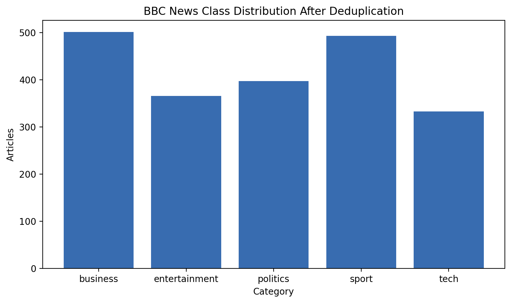
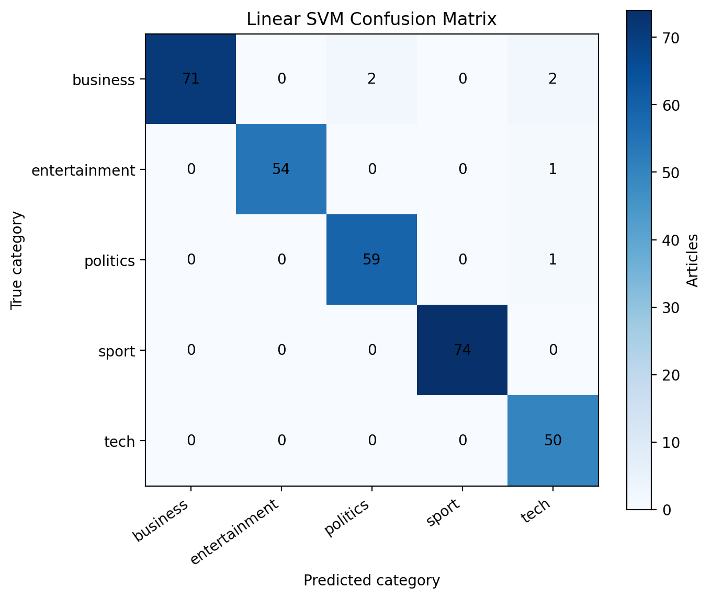
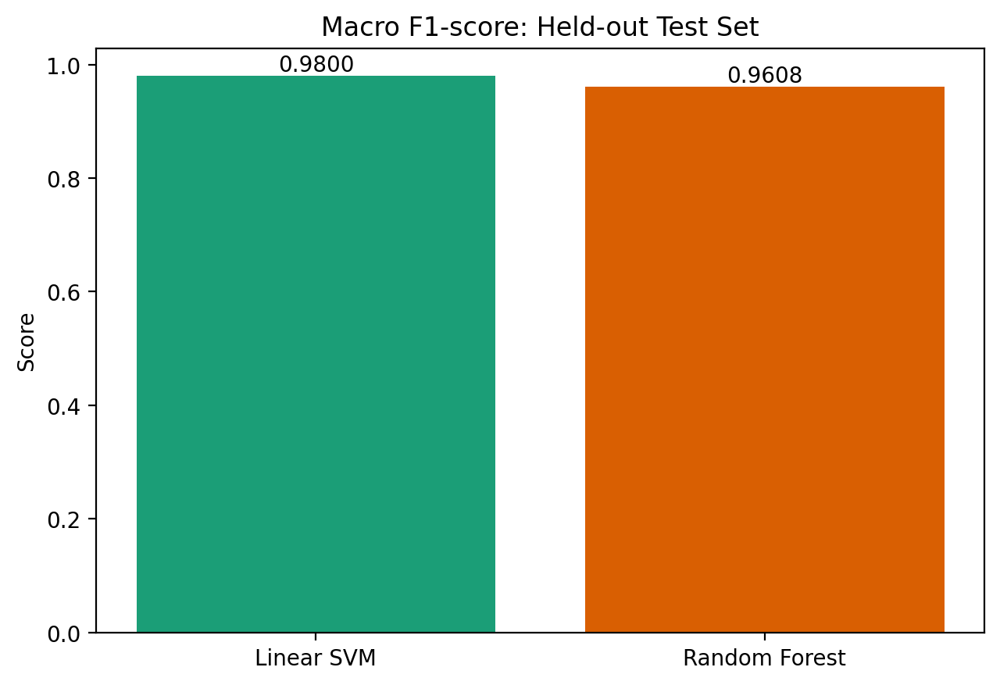
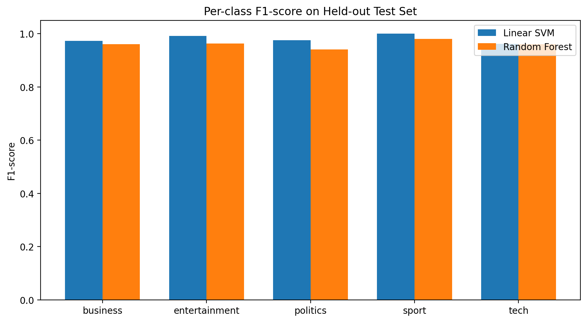

# Phase 1 experiment report

## Setup

The experiment ran on 2 November 2026 on macOS x86_64 with Python 3.13.5 and scikit-learn 1.7.2.
The machine exposed 12 logical CPUs. Dataset preparation retained 2,090 of 2,225 source articles and
created 1,463/313/314 stratified train/validation/test partitions with seed 42.

Validation selected LinearSVC `C=0.5` (macro F1 0.9929) and a 200-tree unlimited-depth Random Forest
(macro F1 0.9582). Each selected configuration was refitted on 1,776 train + validation articles;
the table below reports the untouched 314-article test set.

| Metric | Linear SVM | Random Forest |
|---|---:|---:|
| Accuracy | 0.9809 | 0.9618 |
| Macro precision | 0.9786 | 0.9619 |
| Macro recall | 0.9824 | 0.9604 |
| Macro F1 | 0.9800 | 0.9608 |
| Weighted F1 | 0.9810 | 0.9616 |
| Training time (s) | 2.5878 | 3.8322 |
| Inference (ms/article) | 0.6787 | 0.8299 |
| Artifact size (bytes) | 972,734 | 3,985,932 |

Timings are observed wall-clock measurements from this run and are not hardware-independent.

## Class-level findings

Linear SVM F1 ranged from 0.9615 (`tech`) to 1.0000 (`sport`). Business recall was 0.9467; its four
errors were split between politics and tech. Random Forest F1 ranged from 0.9402 (`politics`) to
0.9801 (`sport`); politics recall of 0.9167 was its clearest weakness. No test category had zero
support (business 75, entertainment 55, politics 60, sport 74, tech 50).

## Selection

Linear SVM was selected from validation evidence. It also produced higher final macro F1 and
accuracy, lower measured inference latency, lower measured fit time, and an artifact roughly one
quarter the Random Forest size. Its full preprocessing pipeline is serialized as
`ml/artifacts/selected_model.joblib`.

## Limitations

The small, historical British corpus makes this an in-domain baseline only. Random resplitting cannot
simulate temporal or source transfer. SimHash is conservative and lexical; it may miss semantically
duplicated stories. The single-machine timing sample has no confidence interval. Scores are not
probabilities. Nigerian multilingual/domain evaluation is required before real-world performance
claims or production routing decisions.

